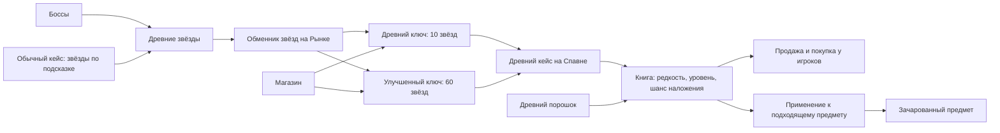

# Prison Classic: книги, ключи и древние зачарования

20 октября 2026 года. Книги выделены в отдельную систему развития. В новых 34 кадрах Древнего кейса показано **31 различное зачарование: 13 обычных, 10 редких, 8 легендарных**. Два кадра Мороза повторяются побайтно. Из пропущенных кадров Аукциона отдельно прочитаны **35 наблюдений книг**: конкретный уровень, шанс наложения, цена и валюта предложения игрока.

## Путь получения и применения

Путь «ключ за донат или звёзды на Рынке» указан пользователем и подтверждается снятыми меню. Обменник продаёт **Древний ключ за 10 звёзд**, **Улучшенный древний ключ за 60**, **Развеиватель за 15**. Оба ключа в подсказках предназначены для **Древнего кейса на Спавне**. [npc_image_6](C:/Users/user/Documents/roblox-prison-research/client-audit/content-analysis/npc-menu-evidence/npc-06.png), [npc_image_7](C:/Users/user/Documents/roblox-prison-research/client-audit/content-analysis/npc-menu-evidence/npc-07.png), [npc_image_9](C:/Users/user/Documents/roblox-prison-research/client-audit/content-analysis/npc-menu-evidence/npc-09.png).

В магазине показаны цены **149** за древний ключ и **349** за улучшенный; порошок — **17**, Развеиватель — **199**, рядом с синим значком валюты магазина. Это не установленные рубли/Robux и не измеренный курс пополнения. [book_case_2](C:/Users/user/Documents/roblox-prison-research/client-audit/content-analysis/book-case-evidence/02.png).

Первая фотография показывает физический Древний кейс и сообщение **«У Вас нет ключа от этого кейса!»**. Дальнейшие кадры — просмотр содержимого, без успешного открытия или применения книги. [book_case_1](C:/Users/user/Documents/roblox-prison-research/client-audit/content-analysis/book-case-evidence/01.png).

## Четыре разных параметра книги

1. **Название и редкость** — тип эффекта и подпись «обычное / редкое / легендарное». Вероятность получить такую редкость не показана.
2. **Уровень I / II / III** — отдельный параметр. Улучшенный древний ключ по подсказке даёт книгу максимального уровня для её типа: у Чистюли это II, у Халка и Стукача — I, у большинства — III.
3. **Шанс зачарования предмета** — число у конкретной книги на Аукционе. Берсерк III встречается с **31% и 99%**; Пластолом II — с **100% и 28%**. Эти примеры доказывают, что уровень не задаёт единственный шанс наложения.
4. **Срабатывание эффекта после наложения** — шанс отравления, молнии, лечения, копания и т. п. Эти вероятности и большая часть коэффициентов не показаны.

Таким образом, максимальный уровень от улучшенного ключа **не означает 100% наложение** и не обещает легендарную редкость. В окне кейса написано: «Чтобы наложить, нужно нажать книгой по желаемому предмету»; ниже явно перечислены совместимые предметы.

## Каталог наблюдаемых книг

### Обычное — 13

| Книга | Уровни | Предметы | Что описано | Источник |
| --- | --- | --- | --- | --- |
| Чистюля | I–II | Шлем | Нужды — туалет, душ и сон — наступают реже. | [book_case_3](C:/Users/user/Documents/roblox-prison-research/client-audit/content-analysis/book-case-evidence/03.png) |
| Барыга | I–III | Кирка, Топор, Лопата, Ножницы | При добыче есть шанс получить ещё один такой же блок; работает и с автопродажей. | [book_case_4](C:/Users/user/Documents/roblox-prison-research/client-audit/content-analysis/book-case-evidence/04.png) |
| Токсичный | I–III | Меч | При нанесении урона есть шанс отравить врага. | [book_case_5](C:/Users/user/Documents/roblox-prison-research/client-audit/content-analysis/book-case-evidence/05.png) |
| Раскалённый | I–III | Поножи | При получении урона есть шанс поджечь противника. | [book_case_6](C:/Users/user/Documents/roblox-prison-research/client-audit/content-analysis/book-case-evidence/06.png) |
| Мороз | I–III | Лук | При попадании стрелой возможно кратковременно снизить скорость игрока. | [book_case_7](C:/Users/user/Documents/roblox-prison-research/client-audit/content-analysis/book-case-evidence/07.png), [book_case_8](C:/Users/user/Documents/roblox-prison-research/client-audit/content-analysis/book-case-evidence/08.png) |
| Пружины | I–III | Ботинки | Постоянный эффект прыгучести. | [book_case_9](C:/Users/user/Documents/roblox-prison-research/client-audit/content-analysis/book-case-evidence/09.png) |
| Громовержец | I–III | Меч, Лук | При нанесении урона есть шанс вызвать молнию на врага. | [book_case_10](C:/Users/user/Documents/roblox-prison-research/client-audit/content-analysis/book-case-evidence/10.png) |
| Боксёр | I–III | Меч, Лук | При нанесении урона есть шанс нанести дополнительный значительный урон и подкинуть противника. | [book_case_11](C:/Users/user/Documents/roblox-prison-research/client-audit/content-analysis/book-case-evidence/11.png) |
| Замешательство | I–III | Меч, Лук | При нанесении урона есть шанс наложить тошноту. | [book_case_12](C:/Users/user/Documents/roblox-prison-research/client-audit/content-analysis/book-case-evidence/12.png) |
| Пожар | I–III | Лук | При попадании стрелой есть шанс создать огненный взрыв под игроком. | [book_case_13](C:/Users/user/Documents/roblox-prison-research/client-audit/content-analysis/book-case-evidence/13.png) |
| Берсерк | I–III | Меч | Если меньше 10 сердец, есть шанс нанести двойной урон. | [book_case_14](C:/Users/user/Documents/roblox-prison-research/client-audit/content-analysis/book-case-evidence/14.png) |
| Бульдозер | I–III | Ботинки | При получении урона есть шанс замедлить противника. | [book_case_15](C:/Users/user/Documents/roblox-prison-research/client-audit/content-analysis/book-case-evidence/15.png) |
| Укрепление | I–III | Нагрудник | При получении урона есть шанс наложить слабость на противника. | [book_case_16](C:/Users/user/Documents/roblox-prison-research/client-audit/content-analysis/book-case-evidence/16.png) |
### Редкое — 10

| Книга | Уровни | Предметы | Что описано | Источник |
| --- | --- | --- | --- | --- |
| Иссушение | I–III | Поножи | При получении урона есть шанс наложить иссушение на противника. | [book_case_17](C:/Users/user/Documents/roblox-prison-research/client-audit/content-analysis/book-case-evidence/17.png) |
| Вихрь | I–III | Меч, Лук | Описание обещает дезориентацию волной ударов; число ударов и точная механика не раскрыты. | [book_case_18](C:/Users/user/Documents/roblox-prison-research/client-audit/content-analysis/book-case-evidence/18.png) |
| Слепота | I–III | Меч, Лук | При нанесении урона есть шанс наложить слепоту. | [book_case_19](C:/Users/user/Documents/roblox-prison-research/client-audit/content-analysis/book-case-evidence/19.png) |
| Халк | I | Нагрудник | Постоянные Сопротивление урону I и Замедление I. | [book_case_20](C:/Users/user/Documents/roblox-prison-research/client-audit/content-analysis/book-case-evidence/20.png) |
| Танк | I–III | Шлем, Нагрудник, Поножи, Ботинки | Даёт постоянные дополнительные сердца. | [book_case_21](C:/Users/user/Documents/roblox-prison-research/client-audit/content-analysis/book-case-evidence/21.png) |
| Обжора | I–III | Шлем | Восстанавливает голод во время сражений. | [book_case_22](C:/Users/user/Documents/roblox-prison-research/client-audit/content-analysis/book-case-evidence/22.png) |
| Ниндзя | I–III | Ботинки | При нанесении удара есть шанс получить скорость. | [book_case_23](C:/Users/user/Documents/roblox-prison-research/client-audit/content-analysis/book-case-evidence/23.png) |
| Стукач | I | Шлем | Ударивший игрок начинает светиться и виден окружающим несколько секунд. | [book_case_24](C:/Users/user/Documents/roblox-prison-research/client-audit/content-analysis/book-case-evidence/24.png) |
| Шныр | I–II | Ботинки | Есть шанс уклониться от удара другого игрока без получения урона. | [book_case_25](C:/Users/user/Documents/roblox-prison-research/client-audit/content-analysis/book-case-evidence/25.png) |
| Проклятие | I–III | Меч, Лук | Удар может временно запретить восстановление здоровья, включая Вампиризм и Просвещённого; после эффекта 5 секунд защиты от повторного проклятия. | [book_case_26](C:/Users/user/Documents/roblox-prison-research/client-audit/content-analysis/book-case-evidence/26.png) |
### Легендарное — 8

| Книга | Уровни | Предметы | Что описано | Источник |
| --- | --- | --- | --- | --- |
| Ярость | I–III | Меч, Лук | Каждый удар по противнику увеличивает последующий урон по нему. | [book_case_27](C:/Users/user/Documents/roblox-prison-research/client-audit/content-analysis/book-case-evidence/27.png) |
| Археолог | I–III | Кирка, Топор, Лопата, Ножницы | При добыче есть шанс получить ускоренное копание. | [book_case_28](C:/Users/user/Documents/roblox-prison-research/client-audit/content-analysis/book-case-evidence/28.png) |
| Просвещённый | I–III | Шлем, Нагрудник, Поножи, Ботинки | При получении урона есть шанс восстановить здоровье. | [book_case_29](C:/Users/user/Documents/roblox-prison-research/client-audit/content-analysis/book-case-evidence/29.png) |
| Пластолом | I–III | Кирка | Может убрать весь слой шахты под игроком; в статистику идёт половина блоков слоя, до 200 штук. | [book_case_30](C:/Users/user/Documents/roblox-prison-research/client-audit/content-analysis/book-case-evidence/30.png) |
| Молот | I–III | Кирка, Топор, Лопата, Ножницы | При добыче может вскопать случайные блоки в некотором радиусе. | [book_case_31](C:/Users/user/Documents/roblox-prison-research/client-audit/content-analysis/book-case-evidence/31.png) |
| Старатель | I–III | Меч, Лук | Увеличивает звёзды с босса в зависимости от доли урона, нанесённого этим оружием. | [book_case_32](C:/Users/user/Documents/roblox-prison-research/client-audit/content-analysis/book-case-evidence/32.png) |
| Общак | I–III | Меч, Лук | Увеличивает долю денег из банка босса в зависимости от доли урона, нанесённого этим оружием. | [book_case_33](C:/Users/user/Documents/roblox-prison-research/client-audit/content-analysis/book-case-evidence/33.png) |
| Вампиризм | I–III | Меч, Лук | Лечит при нанесении урона; величина зависит от урона и уровня зачарования. | [book_case_34](C:/Users/user/Documents/roblox-prison-research/client-audit/content-analysis/book-case-evidence/34.png) |

## Порошок, снятие и взаимодействия

У наблюдаемого порошка написано **«Эффективность: 2%»** и что он увеличивает шанс наложения книги. [coverage_91](C:/Users/user/Documents/roblox-prison-research/client-audit/content-analysis/missed-menu-evidence/auction/091.png). Отдельная локализация донатного порошка описывает **10% эффективности** и правило **каждый процент эффективности = дополнительный процент к шансу наложения**: это текстовое свидетельство прибавления процентных пунктов, без фактического применения на кадрах. [Клиентский текст](C:/Users/user/Documents/roblox-prison-research/client-audit/decoded/ru_RU-classic.json:1134). Числовой предел шанса и списание порошка не проверены. Проценты возле порошка в меню боссов могут относиться к эффективности, но это ещё сопоставление источников, не доказанный формат серверной награды. Поэтому эти проценты не объявлены вероятностью выпадения.

Развеиватель у NPC стоит **15 звёзд**; его описание прямо говорит, что снятые книги **не возвращаются**. [Обменники](C:/Users/user/Documents/roblox-prison-research/client-audit/NPC-MENU-RECOVERY.md).

В локализации отдельно есть сообщение неудачи **«книга порвалась… зачарование не наложилось»**, запрет уже имеющегося зачарования и лимит с подставляемым `%d` — самого числа лимита нет. [Сообщения применения](C:/Users/user/Documents/roblox-prison-research/client-audit/decoded/ru_RU-classic.json:555). Это позволяет записать ожидаемое поведение интерфейса; фактический расход книги, сохранность предмета и поведение разных уровней одного эффекта не проверены.

Кузница банды по описанию позволяет **скрещивать книги одного типа для повышения уровня**; экран просит выбрать **две** такие книги и имеет поле «Шанс: %d%». Цена, числовой шанс и формула результата не получены. [Описание Кузницы](C:/Users/user/Documents/roblox-prison-research/client-audit/decoded/ru_RU-classic.json:797). Эти текстовые правила сохранены отдельно от наблюдаемых действий, чтобы не потерять найденную механику и не объявить её протестированной.

**Проклятие** запрещает лечение, включая Вампиризм и Просвещённого; после окончания описаны **5 секунд защиты от повторного проклятия**. Длительность самого запрета неизвестна. **Берсерк** явно использует условие меньше **10 сердец** и возможный урон ×2. **Халк I** сочетает Сопротивление I и Замедление I.

**Пластолом** сносит слой под игроком; в статистику, по тексту, засчитывается половина блоков слоя, до **200**. Это не автоматическое равенство реальной добычи, денег и статистики: эти счётчики нужно разбирать отдельно.

**Старатель / Общак** связывают бонус звёзд/денег с долей урона боссу именно этим оружием. В текущем UI порог отображён как `Меньше 35урона: бонуса нет.`; совпадающая локализация содержит **35%**. Этот процент восстановлен из текста клиента, а не измерен боем. [Локализация](C:/Users/user/Documents/roblox-prison-research/client-audit/decoded/ru_RU-classic.json:661). Формула роста бонуса неизвестна.

## Наблюдения Аукциона

Это **цены предложения игроков**, не фиксированные цены NPC и не доказательство состоявшихся сделок. Берсерк III с 31% выставлен за 20 000 $, с 99% — за 50 000 $; это наблюдение двух предложений, а не доказанная формула рыночной цены. Кадры 104/105 возвращаются к одному и тому же лоту с таймером.

| Книга | Шанс наложения | Цена предложения | Валюта | Снимок |
| --- | ---: | ---: | --- | --- |
| Берсерк II | 17% | 6000 | игровые деньги | [coverage_92](C:/Users/user/Documents/roblox-prison-research/client-audit/content-analysis/missed-menu-evidence/auction/092.png) |
| Громовержец III | 20% | 7000 | игровые деньги | [coverage_93](C:/Users/user/Documents/roblox-prison-research/client-audit/content-analysis/missed-menu-evidence/auction/093.png) |
| Громовержец II | 56% | 7777 | игровые деньги | [coverage_94](C:/Users/user/Documents/roblox-prison-research/client-audit/content-analysis/missed-menu-evidence/auction/094.png) |
| Чистюля II | 31% | 3000 | игровые деньги | [coverage_95](C:/Users/user/Documents/roblox-prison-research/client-audit/content-analysis/missed-menu-evidence/auction/095.png) |
| Пожар II | 69% | 10000 | игровые деньги | [coverage_96](C:/Users/user/Documents/roblox-prison-research/client-audit/content-analysis/missed-menu-evidence/auction/096.png) |
| Боксёр I | 38% | 5000 | игровые деньги | [coverage_97](C:/Users/user/Documents/roblox-prison-research/client-audit/content-analysis/missed-menu-evidence/auction/097.png) |
| Берсерк III | 31% | 20000 | игровые деньги | [coverage_98](C:/Users/user/Documents/roblox-prison-research/client-audit/content-analysis/missed-menu-evidence/auction/098.png) |
| Замешательство I | 23% | 5000 | игровые деньги | [coverage_99](C:/Users/user/Documents/roblox-prison-research/client-audit/content-analysis/missed-menu-evidence/auction/099.png) |
| Танк III | 21% | 40000 | игровые деньги | [coverage_100](C:/Users/user/Documents/roblox-prison-research/client-audit/content-analysis/missed-menu-evidence/auction/100.png) |
| Шныр II | 43% | 10000 | игровые деньги | [coverage_101](C:/Users/user/Documents/roblox-prison-research/client-audit/content-analysis/missed-menu-evidence/auction/101.png) |
| Укрепление II | 74% | 14500 | игровые деньги | [coverage_102](C:/Users/user/Documents/roblox-prison-research/client-audit/content-analysis/missed-menu-evidence/auction/102.png) |
| Иссушение III | 11% | 15000 | игровые деньги | [coverage_103](C:/Users/user/Documents/roblox-prison-research/client-audit/content-analysis/missed-menu-evidence/auction/103.png) |
| Громовержец III | 62% | 17000 | игровые деньги | [coverage_104](C:/Users/user/Documents/roblox-prison-research/client-audit/content-analysis/missed-menu-evidence/auction/104.png) |
| Громовержец III | 62% | 17000 | игровые деньги | [coverage_105](C:/Users/user/Documents/roblox-prison-research/client-audit/content-analysis/missed-menu-evidence/auction/105.png) |
| Проклятие III | 76% | 80000 | игровые деньги | [coverage_106](C:/Users/user/Documents/roblox-prison-research/client-audit/content-analysis/missed-menu-evidence/auction/106.png) |
| Укрепление II | 3% | 22500 | игровые деньги | [coverage_107](C:/Users/user/Documents/roblox-prison-research/client-audit/content-analysis/missed-menu-evidence/auction/107.png) |
| Берсерк III | 99% | 50000 | игровые деньги | [coverage_108](C:/Users/user/Documents/roblox-prison-research/client-audit/content-analysis/missed-menu-evidence/auction/108.png) |
| Укрепление III | 64% | 65000 | игровые деньги | [coverage_109](C:/Users/user/Documents/roblox-prison-research/client-audit/content-analysis/missed-menu-evidence/auction/109.png) |
| Танк III | 41% | 40000 | игровые деньги | [coverage_110](C:/Users/user/Documents/roblox-prison-research/client-audit/content-analysis/missed-menu-evidence/auction/110.png) |
| Общак I | 50% | 10000 | игровые деньги | [coverage_111](C:/Users/user/Documents/roblox-prison-research/client-audit/content-analysis/missed-menu-evidence/auction/111.png) |
| Бульдозер III | 36% | 35000 | игровые деньги | [coverage_112](C:/Users/user/Documents/roblox-prison-research/client-audit/content-analysis/missed-menu-evidence/auction/112.png) |
| Пластолом II | 100% | 80000 | игровые деньги | [coverage_113](C:/Users/user/Documents/roblox-prison-research/client-audit/content-analysis/missed-menu-evidence/auction/113.png) |
| Пожар III | 30% | 15000 | игровые деньги | [coverage_114](C:/Users/user/Documents/roblox-prison-research/client-audit/content-analysis/missed-menu-evidence/auction/114.png) |
| Археолог I | 89% | 150 | рубины | [coverage_115](C:/Users/user/Documents/roblox-prison-research/client-audit/content-analysis/missed-menu-evidence/auction/115.png) |
| Обжора III | 95% | 200 | рубины | [coverage_116](C:/Users/user/Documents/roblox-prison-research/client-audit/content-analysis/missed-menu-evidence/auction/116.png) |
| Просвещённый III | 47% | 1500 | рубины | [coverage_117](C:/Users/user/Documents/roblox-prison-research/client-audit/content-analysis/missed-menu-evidence/auction/117.png) |
| Пластолом II | 28% | 199 | рубины | [coverage_118](C:/Users/user/Documents/roblox-prison-research/client-audit/content-analysis/missed-menu-evidence/auction/118.png) |
| Пластолом III | 1% | 499 | рубины | [coverage_119](C:/Users/user/Documents/roblox-prison-research/client-audit/content-analysis/missed-menu-evidence/auction/119.png) |
| Просвещённый III | 54% | 1800 | рубины | [coverage_120](C:/Users/user/Documents/roblox-prison-research/client-audit/content-analysis/missed-menu-evidence/auction/120.png) |
| Ярость I | 65% | 200 | рубины | [coverage_121](C:/Users/user/Documents/roblox-prison-research/client-audit/content-analysis/missed-menu-evidence/auction/121.png) |
| Проклятие III | 69% | 699 | рубины | [coverage_122](C:/Users/user/Documents/roblox-prison-research/client-audit/content-analysis/missed-menu-evidence/auction/122.png) |
| Обжора III | 80% | 300 | рубины | [coverage_123](C:/Users/user/Documents/roblox-prison-research/client-audit/content-analysis/missed-menu-evidence/auction/123.png) |
| Проклятие III | 60% | 700 | рубины | [coverage_124](C:/Users/user/Documents/roblox-prison-research/client-audit/content-analysis/missed-menu-evidence/auction/124.png) |
| Археолог III | 49% | 2500 | рубины | [coverage_125](C:/Users/user/Documents/roblox-prison-research/client-audit/content-analysis/missed-menu-evidence/auction/125.png) |
| Просвещённый III | 24% | 2500 | рубины | [coverage_126](C:/Users/user/Documents/roblox-prison-research/client-audit/content-analysis/missed-menu-evidence/auction/126.png) |

## Границы восстановления

В старом словаре клиента есть 38 названий. В этих сериях не наблюдаются: **Экономия, Торнадо, Гнев, Муляр, Землекоп, Дровосек, Охотник**. Их отсутствие в кадрах не доказывает удаление. 31 наблюдаемая книга — не автоматически полный каталог всех сезонов.

Для точного баланса остаются неизвестны распределение выпадения редкостей/типов/уровней, генерация шанса наложения, формула порошка, последствия неудачи, совмещение нескольких книг, коэффициенты и внутренние задержки эффектов, связь с уровнем предмета и серверные проверки.

[Машинная модель книг](C:/Users/user/Documents/roblox-prison-research/client-audit/content-analysis/books-system-recovery.json) · [Новые 34 источника](C:/Users/user/Documents/roblox-prison-research/client-audit/content-analysis/book-case-sources.json) · [Ранее пропущенные источники](C:/Users/user/Documents/roblox-prison-research/client-audit/content-analysis/missed-menu-sources.json)
