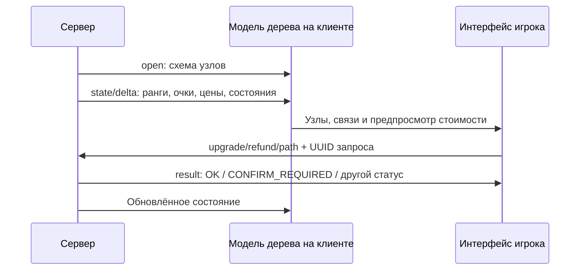

# Два поколения дерева развития Wada

Статический разбор клиента, 19 октября 2026 года. Ниже подтверждённое устройство общего интерфейса Wada. Включение этих компонентов и конкретная схема именно в Prison не установлены.

## Новое дерево: какие данные приходят

Входящие каналы: `w4:t4t:open`, `state`, `delta`, `result`. `state` и `delta` вызывают один парсер обновлений. У обновления проверяется UUID текущего меню. См. [контроллер, строка 10](C:/Users/user/Documents/roblox-prison-research/client-audit/code-analysis/source/addon-wada/00004.java:10).

| Уровень | Поля | Проверки/назначение |
| --- | --- | --- |
| Схема | `protocolVersion`, `uuid`, `schemeVersion` | JSON protocolVersion по умолчанию 1; другое значение отклоняется |
| Возможности | `resetAllowed`, `usePoints`, `requireConnectionToStart`, `revealDepth` | Настройки интерфейса и предпросмотра |
| Оформление | `title`, `description`, `style`, `texts`, `buttons` | Заголовки, оформление, подписи и дополнительные действия |
| Узел | `id`, `kind`, `x`, `y`, `size`, `maxRank` | Непустой id обязателен; maxRank ограничивается снизу единицей |
| Оформление узла | `title`, `description`, `icon`, `tooltip`, `frames` | Получаемые данные, не фиксированный список эффектов Prison |
| Зависимости | `parents`, `parentsMode`, `parentsCount` | Число родителей ограничивается снизу единицей |
| Обновление дерева | `availablePoints`, `spentPoints` | Отсутствующее поле сохраняет предыдущее значение |
| Обновление узла | `id`, `state`, `rank`, `nextCost`, `reason`, `tooltip` | Применяется к известному id; состояние, ранг и цена берутся из обновления |

Источники: [схема](C:/Users/user/Documents/roblox-prison-research/client-audit/code-analysis/source/addon-wada/00443.java:33), [узел](C:/Users/user/Documents/roblox-prison-research/client-audit/code-analysis/source/addon-wada/00380.java:154), [состояние](C:/Users/user/Documents/roblox-prison-research/client-audit/code-analysis/source/addon-wada/00443.java:82).

При `revealDepth > 0` парсер схемы изначально ставит каждому узлу `HIDDEN`. В прочитанных участках число revealDepth не используется как локальный обход графа «показать соседей на N шагов»: позже проверяется положительность для пересчёта кадрирования. Состояния узлов раскрываются через поступающие обновления. Приписывать клиенту неизвестный алгоритм раскрытия на основании одного имени поля нельзя.

## Восстановленные значения перечислений

В декомпилированном Java отображаются обфусцированные поля. Оригинальные runtime-имена установлены по строкам, передаваемым в конструкторы enum в `<clinit>`, и следующему `putstatic`. Игровые классы для этого не запускались.

| Enum | Поля в декомпиляции | Runtime-имена по порядку |
| --- | --- | --- |
| `menu/h/a/d` — вид | a, b, c, d, e | START, NORMAL, NOTABLE, KEYSTONE, DECORATION |
| `menu/h/a/e` — состояние | a, b, c, d, e, f, g | HIDDEN, LOCKED, EXCLUDED, AVAILABLE, AFFORDABLE, PARTIAL, MAXED |
| `menu/h/a/f` — родители | a, b, c, d | CONNECTIVITY, ALL, ANY, AT_LEAST |

Точное сопоставление со смещениями байткода включено в `talentEnumNames` в [semantic-findings.json](C:/Users/user/Documents/roblox-prison-research/client-audit/code-analysis/semantic-findings.json). Наименования разных enum нельзя сопоставлять только по одинаковой букве поля.

Вид допускает обычное развитие, если он не START и не DECORATION. Для прямого запроса повышения UI допускает состояния AVAILABLE, AFFORDABLE и PARTIAL: [проверка узла, строка 87](C:/Users/user/Documents/roblox-prison-research/client-audit/code-analysis/source/addon-wada/00380.java:87). Состояния PARTIAL и MAXED считаются уже изученными для расчёта пути: [enum-предикат, строка 13](C:/Users/user/Documents/roblox-prison-research/client-audit/code-analysis/source/addon-wada/00334.java:13).

Наличие состояния AFFORDABLE не означает, что клиент здесь вычислил цену по формуле: значение состояния и nextCost получает из обновления.

## Как устроен предпросмотр пути

Класс [menu/h/d/a](C:/Users/user/Documents/roblox-prison-research/client-audit/code-analysis/source/addon-wada/00458.java:25) хранит:

- соседство узлов по родительским связям;
- выбранное множество узлов пути для каждого id;
- рассчитанную стоимость каждого выбранного множества.

### Подготовка

При перестроении каждая известная связь `node → parent` добавляется в граф в обе стороны. Использование двустороннего соседства относится к режиму CONNECTIVITY; режимы ALL/ANY/AT_LEAST отдельно используют список родителей узла.

Затем очищаются прежние пути и стоимости. Для узлов в состояниях PARTIAL и MAXED создаётся начальный путь `{id}` стоимостью ноль. Это реальные прочитанные начальные условия; отдельное специальное начальное значение для любого узла типа START здесь не устанавливается.

### Выбор родителей

| Условие | Действие предпросмотра |
| --- | --- |
| Режим CONNECTIVITY либо список родителей пуст | При requireConnectionToStart=true нужен один путь через соседний узел; при false используется пустое множество предшественников |
| ALL | Требуются пути всех указанных родителей |
| ANY | Достаточен путь одного родителя |
| AT_LEAST | Требуются пути `parentsCount` родителей |

Далее кандидаты фильтруются: путь должен существовать и не содержать сам рассматриваемый узел. Если нужного числа допустимых родителей нет, путь для этого шага не строится. Кандидаты сортируются сначала по ранее посчитанной стоимости, при равенстве — по числу узлов их пути. Выбранные пути объединяются в множество, поэтому общий предок не дублируется.

### Улучшение пути

Для обычного обновляемого узла, не находящегося в HIDDEN/EXCLUDED и ещё не изученного, алгоритм добавляет его id к объединению путей родителей. Стоимость — сумма `nextCost` узлов множества, кроме находящихся в PARTIAL/MAXED.

Новый вариант сохраняется, если старой стоимости нет либо новая строго меньше. Если стоимость равна, сохранённое множество не заменяется. Проходы повторяются максимум столько раз, сколько узлов в карте; если проход ничего не изменил, цикл заканчивается раньше. См. [инициализация и проходы, строка 119](C:/Users/user/Documents/roblox-prison-research/client-audit/code-analysis/source/addon-wada/00458.java:119).

На наведении возвращённые узлы подсвечиваются и суммируются для панели цены: [canvas, строка 79](C:/Users/user/Documents/roblox-prison-research/client-audit/code-analysis/source/addon-wada/00234.java:79).

**Ограничение интерпретации:** это алгоритм подбора предпросмотра с локальной сортировкой и последовательным улучшением. Из-за пересечений множеств путей и выбора родителей по их отдельным стоимостям не доказано, что он всегда найдёт глобально минимальное объединение. Цена относится к следующему шагу ещё не изученных узлов; это не сумма всех будущих рангов до maxRank.

## Что отправляет игрок

Исходящий вызов проходит через Wada и получает префикс `w4:`. В таблице описаны поля исследованных писателей; это не предложение отправлять такие сообщения в чужую игру.

| Канал | Последовательность данных после имени канала |
| --- | --- |
| `t4t:upgrade` | UUID меню, UTF-8 id узла, UUID запроса |
| `t4t:refund` | UUID меню, UTF-8 id узла, UUID запроса, boolean подтверждения |
| `t4t:path` | UUID меню, UTF-8 целевого id, UUID запроса, boolean, varint количества, строки id ещё не изученных узлов |
| `t4t:button` | UUID меню, строка id кнопки |

Источники: [refund и upgrade](C:/Users/user/Documents/roblox-prison-research/client-audit/code-analysis/source/addon-wada/00331.java:49), [path](C:/Users/user/Documents/roblox-prison-research/client-audit/code-analysis/source/addon-wada/00331.java:178), [button](C:/Users/user/Documents/roblox-prison-research/client-audit/code-analysis/source/addon-wada/00331.java:240), [обёртка буфера](C:/Users/user/Documents/roblox-prison-research/client-audit/code-analysis/source/addon-wada/00740.java:1).

При запросе создаётся случайный UUID корреляции и сохраняется соответствие «запрос → узел». Это технический идентификатор, а не бросок вероятности успешной прокачки.

Результат принимает UUID меню, UUID запроса, строку статуса и необязательную строку сообщения. `CONFIRM_REQUIRED` открывает подтверждение; `OK` управляет успешной реакцией интерфейса. После state/delta обновляется модель. Исследованные исходящие обработчики не списывают очки и не вычисляют игровой эффект таланта.

Диаграмма отражает обнаруженные направления обмена; порядок отдельных result и state/delta не устанавливает обязательную гарантию серверной реализации.

## Старое дерево

Регистрации используют `w2:tree:scheme_init`, `scheme_update`, `upd_elements`, `upgrade`, `reset_status`, `open_menu`, а также `w2:tree_modal`: [менеджер](C:/Users/user/Documents/roblox-prison-research/client-audit/code-analysis/source/addon-wada/00881.java:20).

Схема идентифицируется UUID. Узлы читаются из буфера, пока остаются данные; после загрузки связываются по переданным целочисленным id: [модель схемы](C:/Users/user/Documents/roblox-prison-research/client-audit/code-analysis/source/addon-wada/00652.java:52).

В конструкторе узла приходят id, размеры/позиция, цвет, текст, флаги, значок/предмет и список id связанных узлов: [строка 225](C:/Users/user/Documents/roblox-prison-research/client-audit/code-analysis/source/addon-wada/01032.java:225). Флаг изученности обновляется из boolean пакета: [строка 100](C:/Users/user/Documents/roblox-prison-research/client-audit/code-analysis/source/addon-wada/01032.java:100).

В локальной проверке доступности есть режим, допускающий одного изученного предшественника, и ветвь, требующая всех. При дополнительном флаге учитываются связи в обратном направлении. Узел без предшественников также зависит от отдельного флага. Названия этих обфусцированных флагов не восстановлены, поэтому они не выданы за именованные правила конкретной расы/класса.

Нажатия могут отправлять `w2:tree:any_click` и `w2:tree:upgrade`: UUID схемы, id узла, номер кнопки мыши. Между обработанными кликами требуется не менее **500 мс**; во время анимации upgrade действие также ограничено: [строка 299](C:/Users/user/Documents/roblox-prison-research/client-audit/code-analysis/source/addon-wada/01032.java:299).

Входящий `tree:upgrade` вызывает визуальное изучение узла. Серверный расчёт цены, проверка валюты и игровой бонус здесь не восстановлены. Пауза 500 мс относится к обработчику нажатия, а не к времени изучения или балансу Prison.

## Что использовать при собственном проектировании

Полезно разделить описание дерева, изменяемое состояние игрока и представление. Передавать стоимость следующего ранга и допустимость действия с сервера, а предпросмотр делать локально. Коррелировать результат с запросом и получать после действия актуальное состояние.

Собственная реализация должна отдельно определить эффекты талантов, экономику, правила возврата, проверки и сохранение. Конкретный перечень талантов и числовой баланс Prison из этого универсального UI не получены.
